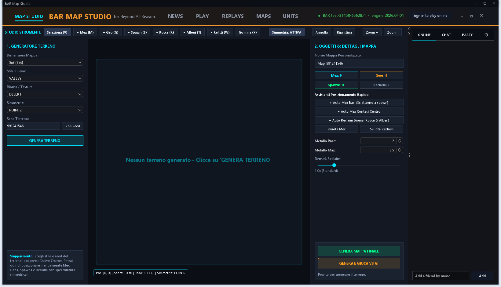

# BAR Map Studio

**Generatore ed editor di mappe per [Beyond All Reason](https://www.beyondallreason.info) (motore Recoil), in Java.**

BAR Map Studio parte dal [Neroxis Map Generator](https://github.com/FAForever/Neroxis-Map-Generator), di cui conserva la generazione procedurale del terreno, e ne riscrive l'esportazione: al posto delle mappe Supreme Commander produce un archivio per BAR con heightmap a 16 bit, texture DXT1/DXT5 in tile, mappe ausiliarie e `mapinfo.lua`, lo scrive nella cartella mappe del gioco e da lì può avviare subito una partita contro le AI.



Versione **beta 0.1** (`AppPaths.VERSION`). Strumento non ufficiale: non è affiliato, approvato o supportato dal team di Beyond All Reason.

## Indice

- [Funzionalità](#funzionalità)
- [Requisiti](#requisiti)
- [Avvio rapido](#avvio-rapido)
- [Generatore da riga di comando](#generatore-da-riga-di-comando)
- [Struttura del repository](#struttura-del-repository)
- [Compilare](#compilare)
- [Creare il pacchetto](#creare-il-pacchetto)
- [Documentazione](#documentazione)
- [Note tecniche](#note-tecniche)
- [Licenza e crediti](#licenza-e-crediti)

## Funzionalità

**MAPS — generazione e modifica**
- 29 stili di rilievo e i biomi di BAR, con seed, simmetria e dimensione a scelta (multipli di 64).
- Terreno procedurale in 2–4 secondi per una 16×16, con anteprima immediata.
- Modifica del rilievo: spazzole, spianamento, quote e livello dell'acqua, pialla pendenze (*ramps*), rigenerazione del ground dalla heightmap.
- Piazzamento di metal spot (con assistenti automatici per base e zone contese), geotermia, spawn, rocce, alberi e relitti.
- Slope map con legenda (veicoli, bot, invalicabile, acqua) e lettura di quota e pendenza sotto il cursore.
- Vista 3D della mappa.
- Export in BAR e partita immediata contro le AI.

**TEXTURES** — materiali per le quattro zone del terreno, regole automatiche per altezza e pendenza, texture di dettaglio e di rilievo.

**OBJECTS & UNITS** — browser 3D delle unità di BAR, duplicazione in unità personalizzate (nome, statistiche, dimensione, fazione, colore), scripting Lua, import di modelli Wavefront `.obj` ed export S3O.

**MAP LIBRARY** — le mappe installate in BAR con anteprima, dimensione, altezze, vento, marea, metal e posizioni di partenza; si aprono nell'editor o si giocano contro le AI.

**Altro** — interfaccia in italiano, inglese, francese e tedesco; aggiornamento dalle release GitHub con verifica SHA-256; segnalazioni dal pulsante FEEDBACK, senza telemetria.

## Requisiti

- **Windows 10 o 11 a 64 bit** per il pacchetto pronto: include il runtime Java, non serve installare nulla.
- **Linux e macOS**: il pacchetto `.tar.gz` è preparato ma **non provato**; serve un Java 25 completo (non il pacchetto *headless*, che non apre finestre).
- **Beyond All Reason installato e avviato almeno una volta**, così che il gioco abbia scaricato i propri file.
- Per compilare: **JDK 25** (il codice è compilato con `--release 25`).

BAR Map Studio trova da solo l'installazione di BAR; se non ci riesce, il pulsante **BAR** in basso a destra permette di sceglierne la cartella.

## Avvio rapido

| Cosa | Come |
| --- | --- |
| Interfaccia grafica | doppio clic su `AVVIA_BAR_MAP_STUDIO.bat` (oppure `app/bar-map-launcher.bat`) |
| Generatore da menu | `app/generate-bar-map.bat` senza argomenti |
| Ultima mappa giocata | `app/play-last-map.bat` |

La prima mappa, in cinque passi: scheda **MAPS** → **GENERA TERRENO** → **+ Auto Base Mexes** e **+ Auto Contested Mexes** → nome della mappa → **GENERA E GIOCA VS AI**.

## Generatore da riga di comando

`generate-bar-map.bat` accetta le opzioni originali di Neroxis (`--help`, `styles`, `--terrain-style`, `--biome`, `--seed`, `--reclaim-density`, …) più quelle introdotte per BAR:

| Opzione | Predefinito | Effetto |
| --- | --- | --- |
| `--bar` | | esporta una mappa BAR; `--out-path` è la cartella `maps` |
| `--bar-scale` | 2 | celle della heightmap per cella SupCom: `256/512/768/1024` diventano 8×8/16×16/24×24/32×32 |
| `--bar-height-scale` | 0.7 | scala verticale: i veicoli di BAR salgono fino a 27°, i ramp restano utilizzabili |
| `--bar-metal` | 2.0 | rendita dei metal spot accanto agli spawn |
| `--bar-metal-min` / `--bar-metal-max` | 2.0 / 3.5 | intervallo di rendita degli altri spot |
| `--bar-reclaim` | 1.0 | metal in rocce e relitti (1 = 600 per posizione di partenza) |
| `--bar-skirmish-script` | | scrive anche lo script di avvio con giocatori, AI e start box |
| `--bar-features` | | cartella con il checkout di [`mapfeatures`](https://github.com/beyond-all-reason/mapfeatures) per gli alberi dei biomi |
| `--map-name` | | rigenera una mappa dal suo nome: l'export è deterministico, i file sono identici byte per byte |

Esempi:

```
generate-bar-map.bat --spawn-count 8 --num-teams 2 --map-size 640    4v4 su 20×20
generate-bar-map.bat --style BIG_ISLANDS --seed 42
generate-bar-map.bat --map-name neroxis_map_generator_...            rigenera una mappa dal nome
```

La mappa viene scritta come `Neroxis_<codice>.sdz` nella cartella `maps` di BAR (la variabile `BAR_DATA` punta a un'altra installazione). Riavviando BAR la mappa compare nella selezione; chi si unisce deve avere lo stesso file, oppure rigenerarla dallo stesso `--map-name`.

`host-game.bat` e `join-game.bat` ospitano una partita direttamente dal proprio computer (porta UDP 8452) senza passare dai server BAR: chi si unisce rigenera la mappa dal nome e non scarica nulla. È una funzione sperimentale, non compare nella lobby pubblica e richiede la stessa versione del generatore per tutti.

## Struttura del repository

```
src/sources/           sorgenti Java
  com/faforever/neroxis/generator/bar/    interfaccia e logica dello Studio (scritta a mano)
  com/faforever/neroxis/exporter/bar/     pipeline BAR: smf/smt, texture, biomi, oggetti
  com/faforever/neroxis/...               generatore Neroxis (decompilato, come riferimento)
  i18n/                  traduzioni (it, en, de, fr)
src_test/              piccoli programmi di prova usati durante lo sviluppo
patch/                 classi compilate, pronte da iniettare in launcher.jar
build/                 script di pacchettizzazione, ProGuard, installer Inno Setup
app/                   cartella di lavoro del launcher (la radice del pacchetto distribuito).
                       Nel repository restano solo gli script .bat e i file che build.ps1 mette
                       nel pacchetto; launcher.jar, runtime, cache e mapfeatures sono ignorati
                       da git
docs/                  documentazione e immagini
tools/                 utilità Python (biomi, traduzioni) e il server lobby finto
release-repo/          README, guide e licenza del progetto pubblico delle release
```

`AUDIT.md` e `PROGRESS.md` sono registri datati e citano ancora il vecchio percorso `extracted/{app}`: quella cartella oggi si chiama `app/`.

## Compilare

`src/sources` contiene due cose diverse:

| Percorso | Cosa è |
| --- | --- |
| `generator/bar/` e `exporter/bar/` | il codice dello Studio, scritto a mano: è questo che si modifica e si ricompila |
| il resto di `src/sources` | la decompilazione JADX del launcher ereditato, tenuta come riferimento |

I file decompilati non sono compilabili con `javac` (per esempio i record risultano `extends Record`) e non vanno corretti: servono a leggere il comportamento del vecchio launcher. Vale anche per le copie ritoccate a mano come `exporter/SCMapExporter.java`, che usa `DataBuffer.getData()` non accessibile. Le 52 classi dei due pacchetti BAR compilano invece senza errori:

```powershell
# dalla radice del progetto, con launcher.jar presente
$src = (Get-ChildItem -Recurse src\sources\com\faforever\neroxis\generator\bar, `
        src\sources\com\faforever\neroxis\exporter\bar -Filter *.java).FullName
javac --release 25 -encoding UTF-8 -cp "app/app/launcher.jar" -d build\classes $src

# inietta le classi aggiornate nell'archivio del launcher
jar uf "app/app/launcher.jar" -C build\classes .
```

`app/app/launcher.jar` e il runtime Java **non sono versionati** (`.gitignore` esclude `app/*` e `*.jar`): la copia di lavoro li contiene, mentre da un clone pulito servono il pacchetto distribuito o il launcher originale per ricostruirli. Lo stesso vale per `mapfeatures`, che i launcher scaricano alla prima generazione.

## Creare il pacchetto

```powershell
powershell -ExecutionPolicy Bypass -File build\build.ps1 -Version beta-0.1
```

| Opzione | Effetto |
| --- | --- |
| `-Version` | nome della versione, usato nei pacchetti e nell'installer |
| `-NoObfuscate` | salta ProGuard (pacchetto di prova) |
| `-FetchTools` | scarica ProGuard con Maven in `build\tools\proguard` se manca |

Lo script produce in `dist\`: la cartella portabile `BARMapStudio\`, lo zip di Windows, il `.tar.gz` per Linux e macOS, l'installer `.exe` se Inno Setup è installato e `mapping-<versione>.txt`. **Il file `mapping-*.txt` non va distribuito**: annulla l'offuscamento. Serve un JDK con la cartella `jmods` (`JAVA_HOME` oppure `scoop\apps\temurin21-jdk\current`); Python 3, se presente, viene usato per verificare che il jar non contenga riferimenti al vecchio launcher.

Per pubblicare una versione nuova la procedura completa è in `build/RELEASE.txt`.

## Documentazione

| Documento | Contenuto |
| --- | --- |
| [`AUDIT.md`](AUDIT.md) | audit tecnico: architettura, cause dei blocchi di generazione, correzioni |
| [`PROGRESS.md`](PROGRESS.md) | registro dei commit, roadmap e stato delle funzionalità |
| [`piano_vista3d_texture.md`](piano_vista3d_texture.md) | piano della vista 3D e del Texture Studio |
| [`docs/GENERATORE-NEROXIS.md`](docs/GENERATORE-NEROXIS.md) | generatore Neroxis per BAR: opzioni, conversioni, formati |
| [`docs/BAR-INTEGRATION.md`](docs/BAR-INTEGRATION.md) | mappe generate nelle lobby multiplayer: checksum, `!nextmap`, cosa servirebbe lato BAR |
| [`release-repo/docs/GUIDE.md`](release-repo/docs/GUIDE.md) · [`GUIDA.md`](release-repo/docs/GUIDA.md) | guida utente in inglese e in italiano |

## Note tecnici

- **Export deterministico**: lo stesso `--map-name` produce gli stessi byte su ogni macchina (si usa `StrictMath` come nel resto di Neroxis), quindi il checksum dell'archivio coincide tra chi genera la mappa localmente.
- **Conversione**: la heightmap SupCom viene ripulita (filtro mediano e bilaterale), riscalata in bicubico e il livello dell'acqua portato a 0; i punti di massa diventano metal spot con rendita crescente per distanza dagli spawn; gli idrocarburi diventano geotermia.
- **Dati utente**: impostazioni, cache e registri stanno in `%APPDATA%\BARMapStudio` su Windows (`~/.config/BARMapStudio` su Linux), separati dal programma, così un aggiornamento non li tocca.
- **Rete**: all'avvio il programma chiede a GitHub se esiste una versione più recente; l'unico altro invio è la segnalazione, e solo premendo Send. Nessuna telemetria.

## Licenza e crediti

BAR Map Studio è © 2026 Kratoswer, gratuito per uso personale e non commerciale; il testo completo e l'elenco delle librerie di terze parti sono in [`release-repo/LICENSE.txt`](release-repo/LICENSE.txt) (la stessa copia che `build.ps1` mette nel pacchetto).

È costruito sul [Neroxis Map Generator](https://github.com/FAForever/Neroxis-Map-Generator) (MIT License, © 2020 Peter Ziegler). Beyond All Reason e i suoi contenuti appartengono ai rispettivi autori: il programma legge i file di gioco dall'installazione dell'utente e non li include.
