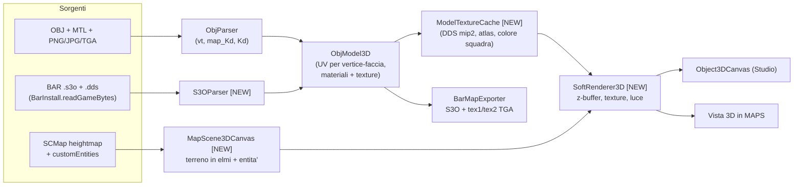

# Piano: Vista 3D di MAPS in scala BAR + modelli con texture

## Obiettivo
1. Aggiungere in **MAPS**, subito dopo `Slope Map [L]`, una **vista 3D della mappa** in scala reale BAR (elmi). La vista mostra il terreno generato e gli **oggetti realmente piazzati**, permette di selezionarli e di **scalarli in tempo reale**, e resta sincronizzata con la mappa 2D.
2. Correggere il caricamento dei modelli: i modelli devono **vedersi con le texture**, sia in anteprima sia in gioco. Vale per gli OBJ con immagini, per gli OBJ con soli colori `.mtl` e per i modelli ufficiali BAR (`.s3o` + `.dds`).

## Cosa ho verificato durante la ricerca

| Fatto | Fonte |
|---|---|
| 1 cella heightmap = `8 × squaresPerCell` = **16 elmi** (MAPS esporta con `squaresPerCell=2`) | `BarMapExporter` riga 133, `MapStudioPanel` riga 1603 |
| Altezza terreno in elmi = `(raw × heightMapScale − livelloMare) × 16 × 0.7` | `BarMapExporter.buildHeights()` |
| Posizione di un oggetto in gioco = `posizione (celle) × 16` | spawner gadget, `BarMapExporter` riga ~1066 |
| `BarInstall.readGameBytes()` legge qualsiasi file del gioco installato | `Units.readPicture()` |
| `objects3d/units/armcom.s3o`: altezza **64 elmi**, raggio 32, texture `Arm_color.dds` / `Arm_other.dds` | test (probe) eseguito ora |
| Texture BAR = atlanti **4096² DXT5**, 13 mipmap; mip 2 (1024²) decodificata in **10 ms** | test `DDSReader` eseguito ora |

> [!WARNING]
> I preset di altezza del commit precedente usano **45m** per il Comandante: il valore reale è **~64 elmi**. In fase di implementazione li ricalcolerò dai modelli veri (`armcom`, `armpw` ecc.).

---

## User Review Required

> [!IMPORTANT]
> **Tecnologia di rendering.** Propongo un **rasterizzatore software con z-buffer** in Java puro, senza nuove dipendenze, con texture vere, luce e colore squadra. Rispetto all'attuale `Object3DCanvas` (pittore + `Graphics2D.fill`) gestisce correttamente le intersezioni, decine di migliaia di triangoli e le texture per pixel.
> L'alternativa è OpenGL (LWJGL/JOGL): più veloce, ma aggiunge circa 5–10 MB di librerie native al launcher e richiede driver adeguati. Consiglio il software. Lo stesso motore sostituirà anche il viewport dello Studio 3D, così le texture si vedranno anche lì.

> [!IMPORTANT]
> **La scala in BAR è per *tipo*, non per singola istanza.** Il motore Spring/Recoil non può scalare una singola unità o feature in gioco, quindi ogni scala diversa richiede un `.s3o` diverso. Proposta: scalando un oggetto nella vista 3D si scalano **tutte le istanze di quel tipo**. Un tasto **"Crea variante"** genera un nuovo tipo (`custom_x_v2`) con scala propria, esportato come modello separato.

---

## Open Questions

1. **Disposizione della vista 3D in MAPS.** Quale preferisci?
   - (a) **Affiancata**: 2D a sinistra e 3D a destra con divisore regolabile, attivata dal pulsante `Vista 3D [V]` dopo Slope Map. *(consigliata)*
   - (b) **Alternata**: il pulsante sostituisce il 2D con il 3D a tutto schermo.
   - (c) Finestra separata, utile con due monitor.
2. **Colore squadra sui modelli personalizzati.** Teniamo sempre i colori originali (alpha 255, come ora), oppure aggiungiamo un'opzione "zone colore squadra" che tinge le parti scure o quelle scelte?
3. **Unità ufficiali BAR piazzate in mappa** (es. `armcom`, torrette). Le mostriamo anche loro con il modello vero dal gioco? *(consigliato: sì, costa poco grazie al lettore S3O)*
4. **Spostare gli oggetti trascinandoli nella vista 3D**: lo vuoi già in questa fase, o bastano selezione, scala e rotazione (lo spostamento resta nel 2D)?

---

## Architettura



---

## Proposed Changes

### 1. Motore di rendering

#### [NEW] `SoftRenderer3D.java`
- Framebuffer `int[]` più z-buffer `float[]`, disegnato poi su un `BufferedImage` (`TYPE_INT_RGB`).
- Rasterizzazione dei triangoli a baricentriche con UV corrette per prospettiva, campionamento della texture (nearest/bilineare) e luce Lambert più ambiente.
- **Colore squadra**: `rgb = mix(teamColor, texRGB, texAlpha)`, la stessa regola di BAR per `tex1.alpha`.
- Righe del framebuffer divise in bande, renderizzate in parallelo (`IntStream.parallel`).
- **Risoluzione dinamica**: metà risoluzione mentre trascini la camera, piena da fermo.

```java
public void drawMesh(RenderMesh m, Matrix4 modelView, Matrix4 proj, Texture tex, int teamRgb);
public void drawTerrain(float[] heights, int w, int h, float cellElmos, BufferedImage colorMap);
```

#### [MODIFY] `Object3DCanvas.java`
- Usa `SoftRenderer3D` al posto del pittore Graphics2D, così le texture si vedono anche nello Studio.
- Righello e sagoma usano il **Comandante vero** (`armcom.s3o` caricato dal gioco, grigio semitrasparente) quando BAR è installato. Se il gioco non c'è, resta la sagoma attuale.

---

### 2. Caricamento modelli e texture

#### [NEW] `S3OParser.java`
- Legge l'header S3O, l'albero dei *piece* (applica gli offset in modo ricorsivo), i vertici (pos, normale, UV) e le primitive (triangoli, triangle strip, quad), più i nomi `tex1`/`tex2`.
- Restituisce un `ObjModel3D` con UV per vertice-faccia e il riferimento alla texture.

#### [NEW] `ModelTextureCache.java`
- Carica `unittextures/<tex1>` dal gioco, decodifica il DDS a **mip 2 (1024²)** e lo tiene in cache: un atlante serve tutti i modelli Armada, uno tutti i Cortex ecc.
- Per gli OBJ carica le immagini indicate da `map_Kd` (PNG/JPG/BMP via `ImageIO`, TGA con un piccolo lettore dedicato).

#### [MODIFY] `ObjParser.java`
- Legge `map_Kd` (anche con opzioni `-s`, `-o` e percorsi con spazi), oltre a `Kd` e `d`.
- **Bug da correggere**: oggi la palette dei colori `Kd` sovrascrive le UV `vt` reali. Nuova regola per ogni materiale:
  - se ha `map_Kd`, uso UV `vt` + immagine;
  - altrimenti uso il colore `Kd` (cella della palette).
- Se `mtllib` manca o non è leggibile, cerca automaticamente `<nome>.mtl`, `<nome>.png` o `texture.png` nella stessa cartella.

#### [MODIFY] `ObjModel3D.java`
- Nuova struttura per i materiali: `Material { String name; int kdRgb; BufferedImage diffuse; }`.
- **Atlante unico in esportazione**: BAR accetta *una sola* `tex1` per modello. Ogni immagine dei materiali (più la palette `Kd`) viene impacchettata in un atlante (max 2048²) e le UV vengono rimappate nella sua cella.
- Generazione di **`tex2`** (R=riflesso 30, G=luce propria 0, B=riflessione 40, A=255) invece di stringa vuota, perché senza `tex2` lo shader BAR rende il modello opaco e piatto.
- Verifica in esportazione della convenzione V di S3O (vedi Verifica, punto 2).

#### [MODIFY] `BarMapExporter.java`
- Scrive `unittextures/<id>_tex1.tga` (atlante) e `<id>_tex2.tga` e li referenzia nell'S3O.
- Alpha di `tex1`: 255 (colori originali), oppure la maschera colore squadra se approvata alla domanda 2.

---

### 3. Vista 3D della mappa in MAPS

#### [NEW] `MapScene3DCanvas.java`
- **Terreno**: mesh dalla heightmap di `SCMap` convertita in elmi con le formule dell'exporter. LOD con passo adattivo (max ~256×256 vertici). Colorata con la `groundPreview` già generata; overlay Slope Map opzionale; piano dell'acqua a `waterElevation`.
- **Entità**: tutte le `PlacedCustomEntity` del canvas 2D, posizionate a `pos × 16` elmi, appoggiate al terreno (altezza campionata) e ruotate con `rotation`. Si disegnano il modello con texture, scalato con `entity.getScale()`, e il footprint a terra.
- Mostra anche spawn e mex come marker e, se approvato, le unità ufficiali col modello vero.
- **Camera stile RTS**: orbita (tasto sinistro), pan (destro/centrale), zoom (rotella), `F` = inquadra la selezione, `Home` = tutta la mappa.
- **Selezione**: click su un oggetto (ray-pick sulle bounding box) per selezionarlo, evidenziato in ciano. La selezione è sincronizzata col canvas 2D in entrambe le direzioni.
- **Scala in tempo reale**:
  - `Shift + rotella` sull'oggetto selezionato: ±5% per scatto;
  - pannello HUD con slider/spinner `Scala`, altezza e larghezza in metri, preset `Cmd / T1 / Edificio / Albero` (altezze reali BAR) e tasto `Crea variante`;
  - `R` / `Shift+R`: ruota di 15°.
- Una **sagoma Comandante** opzionale accanto all'oggetto selezionato per il confronto.

#### [MODIFY] `MapStudioPanel.java`
- Nella HUD dock, subito dopo `Slope Map [L]`: toggle **`Vista 3D [V]`** e scorciatoia `V`.
- Centro della finestra: `JSplitPane` 2D | 3D (layout secondo la risposta 1).
- Rinfresco della scena quando cambiano mappa, ground o entità (`canvas.setChangeListener`, `setMapAndGround`).

#### [MODIFY] `MapStudioCanvas.java`
- Espone `getSelectedCustomEntity()` / `setSelectedCustomEntity()` e un listener di selezione, per la sincronizzazione 2D↔3D.
- Espone `getHeightElmosAt(x, z)` usato da scena ed entità.

#### [MODIFY] `ObjectEntity.java` / `ReadyObjectsTray.java` / `ObjectsUnitsStudioPanel.java`
- Preset di altezza ricalcolati dai modelli BAR reali.
- `createVariant(float scale)` per la gestione delle varianti.

---

## Verification Plan

### Automated Tests (script nella cartella scratch, eseguiti da me)
1. **Parser S3O**: carico `armcom.s3o` e verifico numero di piece/vertici e bounding box ≈ 64 elmi.
2. **Render offscreen su PNG** (li vedrò e li incollerò nel walkthrough):
   - `armcom` con `Arm_color.dds`. Se il render è corretto, la convenzione UV/V del parser S3O è giusta, e la stessa convenzione verrà usata per gli OBJ esportati;
   - `Little Man` con i colori `.mtl`;
   - un OBJ di test con texture PNG (creato da me: cubo a scacchiera con scritta) per verificare l'orientamento;
   - una scena completa: terreno della mappa corrente + oggetti piazzati + Comandante di riferimento.
3. **Round-trip in esportazione**: OBJ → S3O esportato → riletto con `S3OParser` → render PNG. Deve essere identico al render dell'OBJ originale (stesse UV, texture e scala).
4. **Performance**: tempo per frame della scena (obiettivo < 60 ms a 1280×720 con circa 100k triangoli).
5. Compilazione con `javac`, iniezione in `launcher.jar`, commit.

### Manual Verification (da fare tu)
1. MAPS: genera una mappa e premi `Vista 3D [V]`. Terreno e oggetti devono essere in scala, con il Comandante come riferimento.
2. Seleziona un oggetto e scalalo con `Shift + rotella` o con lo slider: il 2D (footprint) e la lista si aggiornano.
3. Importa un OBJ con texture PNG: si deve vedere con texture nello Studio, nella vista 3D e **in gioco**.
4. Avvia la partita e confronta dimensioni e colori in-game con l'anteprima.
